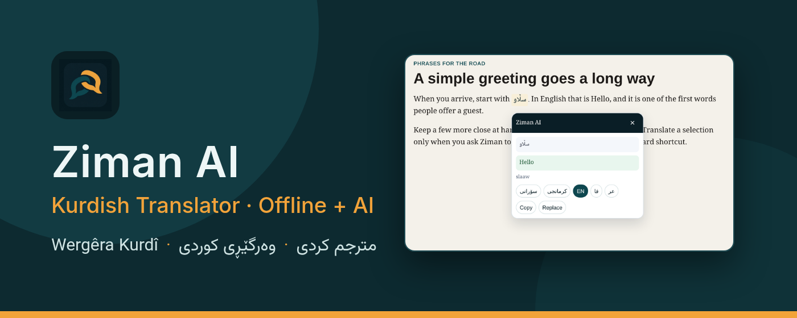
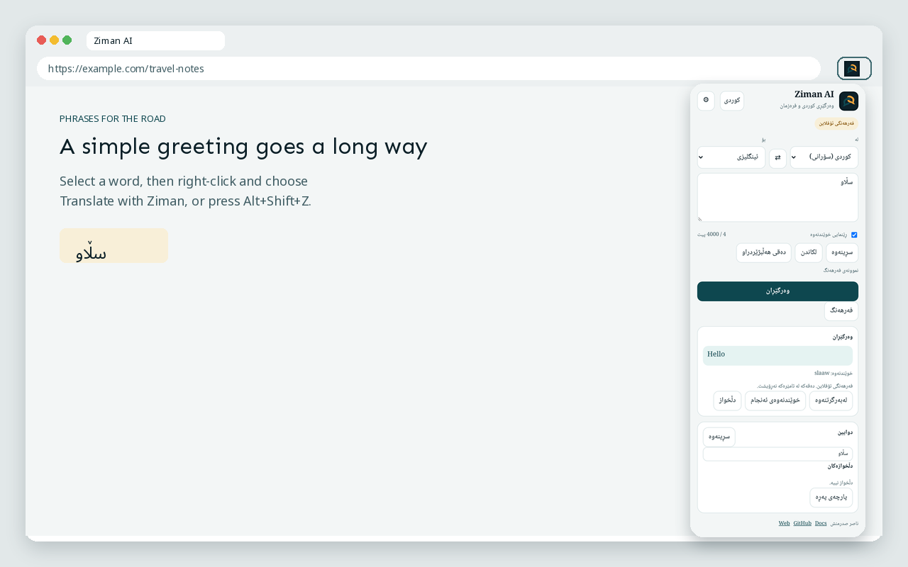
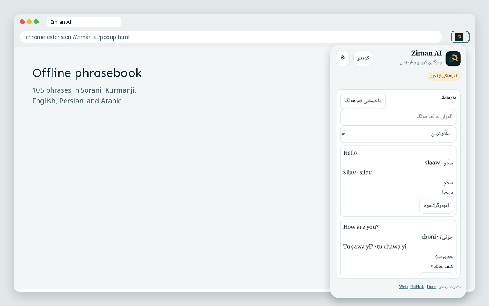
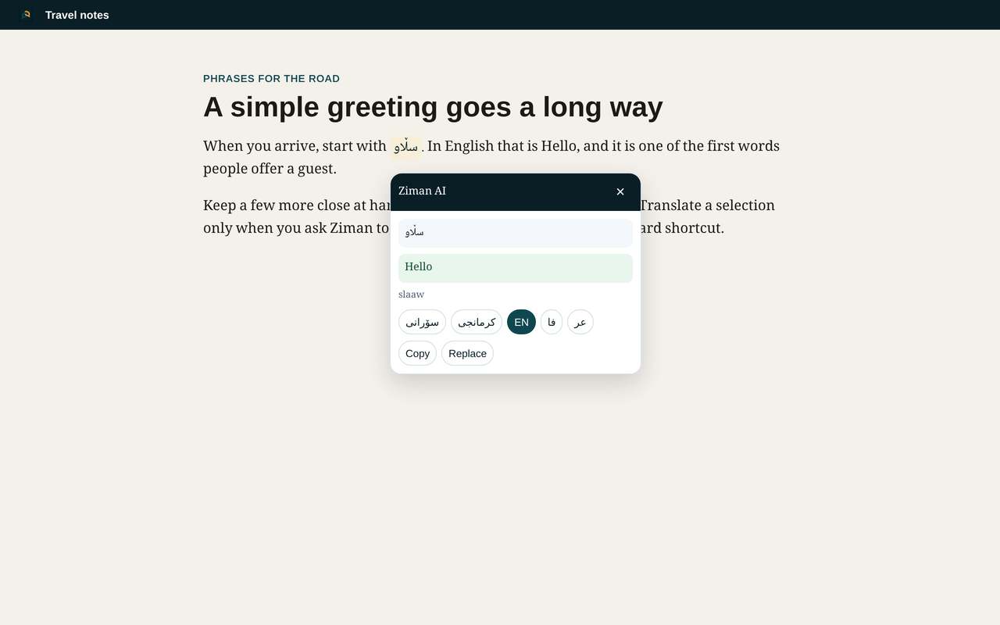
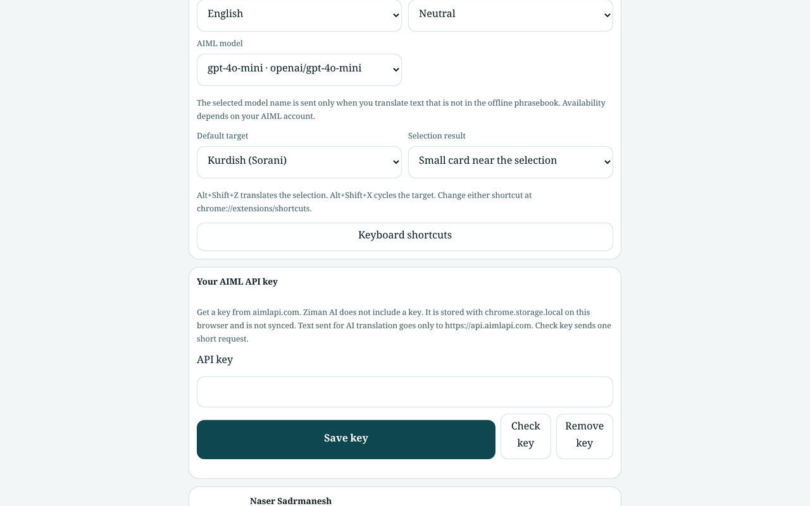
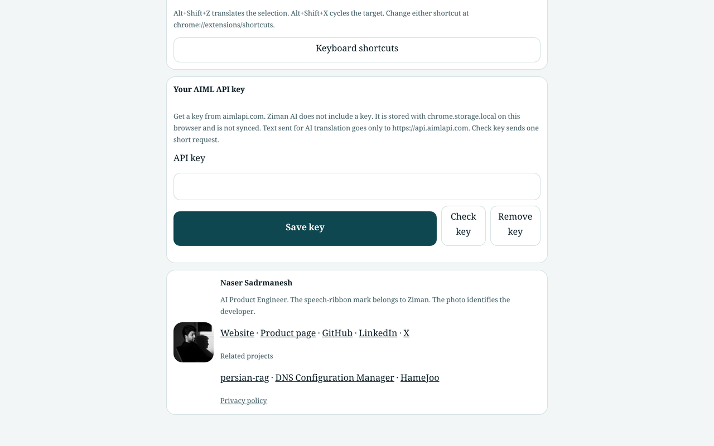

# Ziman AI

<p align="center">
  
</p>

<p align="center">
  
</p>

<p align="center">
  Kurdish (Sorani and Kurmanji) and multilingual translator for Google Chrome.<br>
  Manifest V3 · Version 1.2.3
</p>

<p align="center">
  <a href="https://chromewebstore.google.com/detail/ziman-ai-kurdish-translat/cjmmnobnimheoeeojobgfkgbdbohcjkn"><strong>Install from Chrome Web Store</strong></a>
  ·
  <a href="https://sadrmanesh.github.io/ziman-ai/">Product page</a>
  ·
  <a href="https://github.com/sadrmanesh/ziman-ai">Repository</a>
  ·
  <a href="PRIVACY.md">Privacy</a>
</p>

An offline phrasebook answers a fixed set of common phrases on this device. Any other sentence needs your own [AIML API](https://aimlapi.com/) key. The extension does not include a key, and it does not send phrasebook matches to a server.

Ziman does not open when you merely click or select text. You translate with the context menu, a keyboard shortcut, or the toolbar popup.

## Developer

**Naser Sadrmanesh (ناصر صدرمنش)**
AI Product Engineer

- Website: https://sadrmanesh.github.io/
- GitHub: https://github.com/sadrmanesh
- LinkedIn: https://www.linkedin.com/in/sadrmanesh
- X: https://x.com/nasersadrmanesh
- Repository: https://github.com/sadrmanesh/ziman-ai

The product mark is two interlocking speech ribbons on a dark tile, in `icons/`.

## What it does

- Translates between Kurdish Sorani, Kurdish Kurmanji, English, Arabic, Persian, Turkish, French, German, Spanish, Russian, Chinese, and Japanese.
- Looks up an exact offline phrase before asking the network. The phrasebook has 105 phrases in five languages (Sorani, Kurmanji, English, Persian, Arabic) across nine categories, with letter normalization, a “did you mean” suggestion, and a labeled word-by-word fallback.
- Sends other text to `https://api.aimlapi.com/v1/chat/completions` only when a key is saved in Settings and you ask for a translation.
- Remembers recent translations and saved phrases on this device.
- Can read the current selection, or a short excerpt of the page title and main text, after you ask it to.
- Optional pronunciation guide for Kurdish phrases. It is approximate.

## What it does not do

- It does not invent a translation when a phrase is missing and no key is saved.
- It does not accept a raw OpenAI, Anthropic, or Google key unless AIML accepts that key on your account. This project only talks to `api.aimlapi.com`.
- It does not replace every node on a page. Page translation is one capped excerpt.
- It does not claim support for Firefox, Safari, or Edge.

## Install

[Install from Chrome Web Store](https://chromewebstore.google.com/detail/ziman-ai-kurdish-translat/cjmmnobnimheoeeojobgfkgbdbohcjkn)

## Install from source

1. Clone the repository:

   ```bash
   git clone https://github.com/sadrmanesh/ziman-ai.git
   cd ziman-ai
   ```

2. Open `chrome://extensions/`.
3. Turn on Developer mode.
4. Choose **Load unpacked** and select this folder (the folder that contains `manifest.json`).

Then open Settings from the popup. Paste an AIML key if you want sentences beyond the offline glossary. A saved key is sent only to `https://api.aimlapi.com`.

## Translate a selection

- Right-click selected text and choose **Translate with Ziman**, then pick a target language or the last used language.
- Press `Alt+Shift+Z` to translate the selection. If nothing is selected, the popup opens.
- Press `Alt+Shift+X` to cycle the target among Sorani, Kurmanji, English, Persian, and Arabic.

Both shortcuts can be changed at `chrome://extensions/shortcuts`. The result is a small card next to the selection, unless Settings is set to open the popup instead. The card closes with Escape, a click outside it, or a page scroll.

## Screenshots

| Toolbar popup | Offline phrasebook | Result card on a page |
|:--:|:--:|:--:|
|  |  |  |

| Settings | About |
|:--:|:--:|
|  |  |

Promo tiles: [small 440×280](docs/assets/store/promo-440x280.png) · [marquee 1400×560](docs/assets/store/marquee-1400x560.png)

## Privacy

The key is stored with `chrome.storage.local`. Language preferences use `chrome.storage.sync` and do not include the key. Recent translations stay local until you clear them. Selected text is sent to `api.aimlapi.com` only when AI translation is used. Details are in [PRIVACY.md](PRIVACY.md) and at [the product privacy page](https://sadrmanesh.github.io/ziman-ai/privacy/).

Permissions: `storage`, `activeTab`, `scripting`, and `contextMenus`. The only host permission is `https://api.aimlapi.com/*`.

## Related projects

Phrase matching uses Persian, Arabic, and Kurdish letter-folding rules adapted from [persian-rag](https://github.com/sadrmanesh/persian-rag), Naser Sadrmanesh’s Persian-first RAG toolkit. `scripts/eval-phrasebook.js` measures phrasebook lookup quality on a held-out set of typed variants, in the same precision-and-recall spirit as [llm-search-eval](https://github.com/sadrmanesh/llm-search-eval).

Other shipped Chrome extensions by the same author: [DNS Configuration Manager](https://sadrmanesh.github.io/chrome-dns-manager/) and [HameJoo](https://hamejoo.github.io/hamejoo-chrome/). More projects: [sadrmanesh.github.io](https://sadrmanesh.github.io/).

## Development

```bash
npm test
npm run lint
npm run eval:phrasebook
npm run package
```

The package script writes `dist/ziman-ai-1.2.3.zip` with only the files Chrome loads at runtime.

The product site in `docs/` is built with MkDocs Material:

```bash
pip install -r requirements-docs.txt
mkdocs build --strict
```

## License

[MIT](LICENSE). Copyright (c) 2025 Naser Sadrmanesh.

## کوردی سۆرانی

<div dir="rtl">

زمان، وەرگێڕی کوردی بۆ گووگڵ کرۆم: وەرگێڕان لە کوردیی سۆرانی و کرمانجی بۆ ئینگلیزی، فارسی و عەرەبی و بە پێچەوانەوە.

- **فەرهەنگی کوردیی ئۆفلاین:** ١٠٥ دەستەواژەی ڕۆژانە بە سۆرانی، کرمانجی، ئینگلیزی، فارسی و عەرەبی، لە نۆ بەشدا.
- **گەڕانی زیرەک:** جیاوازیی پیتە عەرەبی و فارسی و کوردییەکان دەناسێتەوە و «مەبەستت ئەمە بوو؟» پێشنیار دەکات.
- **وەرگێڕانی زیرەکی دەستکرد** بۆ هەر ڕستەیەک بە کلیلی AIMLی خۆت. کلیلەکە تەنها لەم وێبگەڕەدا دەمێنێتەوە.
- **هەرگیز خۆی ناکرێتەوە:** کرتەی ڕاست لەسەر دەقی هەڵبژێردراو و هەڵبژاردنی **Translate with Ziman**، یان `Alt+Shift+Z`. `Alt+Shift+X` زمانی مەبەست دەگۆڕێت.
- **بێ چاودێری، بێ ڕیکلام.**

[لە Chrome Web Store دایبمەزرێنە](https://chromewebstore.google.com/detail/ziman-ai-kurdish-translat/cjmmnobnimheoeeojobgfkgbdbohcjkn) · پەڕەی بەرهەم: [sadrmanesh.github.io/ziman-ai/ku/](https://sadrmanesh.github.io/ziman-ai/ku/) · گەشەپێدەر: [ناصر صدرمنش](https://sadrmanesh.github.io/)

</div>

## Kurdî Kurmancî

Ziman, wergêra Kurdî ji bo Google Chrome: ji Kurmancî û Soranî bo Îngilîzî, Farisî û Erebî, û berevajî.

- **Ferhenga Kurdî ya offline:** 105 hevokên rojane bi Kurmancî, Soranî, Îngilîzî, Farisî û Erebî, di neh beşan de.
- **Lêgerîna jîr:** cudahiya tîpên Erebî, Farisî û Kurdî nas dike û “Mebesta te ev bû?” pêşniyar dike.
- **Wergera bi zekaya çêkirî** ji bo her hevokê, bi mifteya xwe ya AIML. Mifte tenê di vê gerokê de dimîne.
- **Qet bi serê xwe venabe:** klîka rastê li ser nivîsa hilbijartî û **Translate with Ziman**, an `Alt+Shift+Z`. `Alt+Shift+X` zimanê armanc diguherîne.
- **Bê şopandin, bê reklam.**

[Ji Chrome Web Storeê saz bike](https://chromewebstore.google.com/detail/ziman-ai-kurdish-translat/cjmmnobnimheoeeojobgfkgbdbohcjkn) · Rûpela berhemê: [sadrmanesh.github.io/ziman-ai/kmr/](https://sadrmanesh.github.io/ziman-ai/kmr/) · Pêşdebir: [Naser Sadrmanesh](https://sadrmanesh.github.io/)

## فارسی

زمان برای ترجمهٔ کردی سورانی و کرمانجی و چند زبان دیگر است. عبارت‌های آماده روی دستگاه ترجمه می‌شوند. برای جمله‌های دیگر کلید AIML خودتان لازم است. افزونه کلید همراه ندارد و با کلیک یا انتخاب متن به‌تنهایی باز نمی‌شود.

[نصب از Chrome Web Store](https://chromewebstore.google.com/detail/ziman-ai-kurdish-translat/cjmmnobnimheoeeojobgfkgbdbohcjkn) — توسعه‌دهنده: ناصر صدرمنش. وب‌سایت: https://sadrmanesh.github.io/ — مخزن: https://github.com/sadrmanesh/ziman-ai — صفحهٔ محصول: https://sadrmanesh.github.io/ziman-ai/
