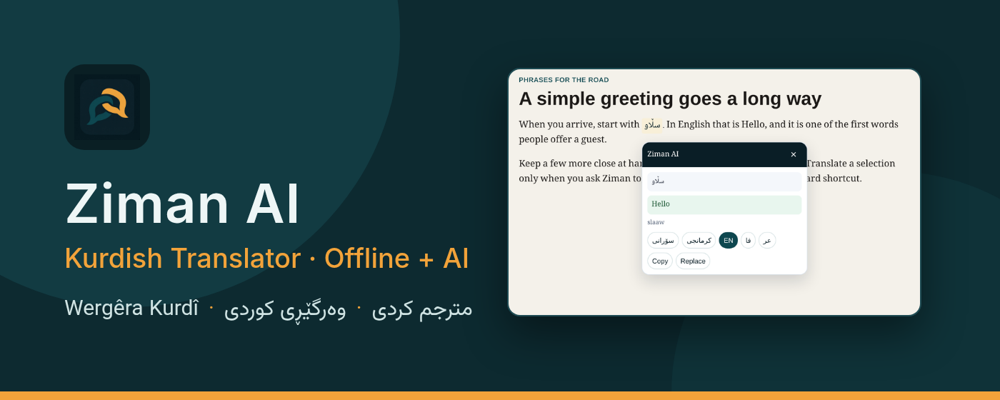
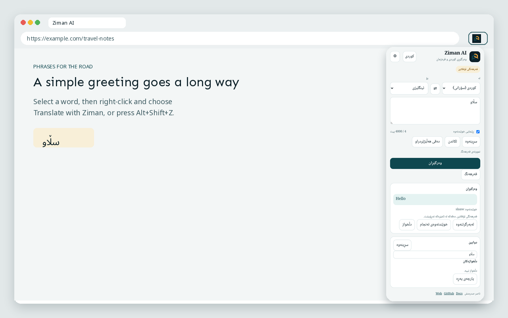
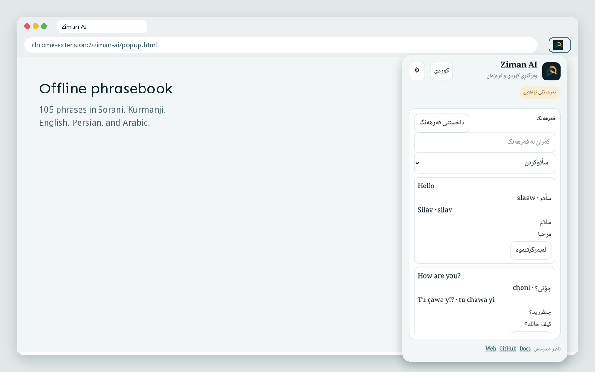
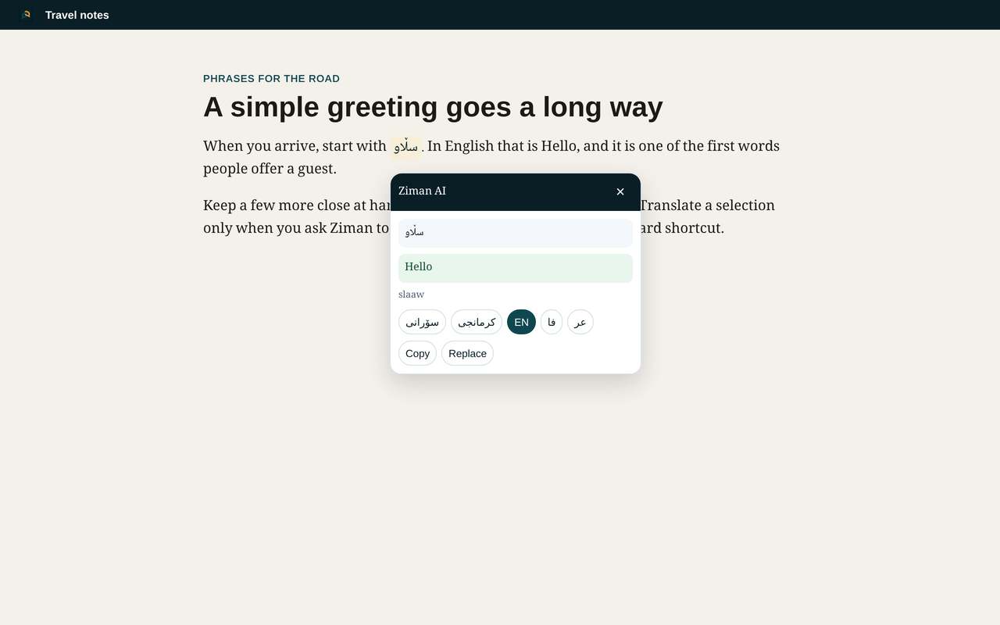
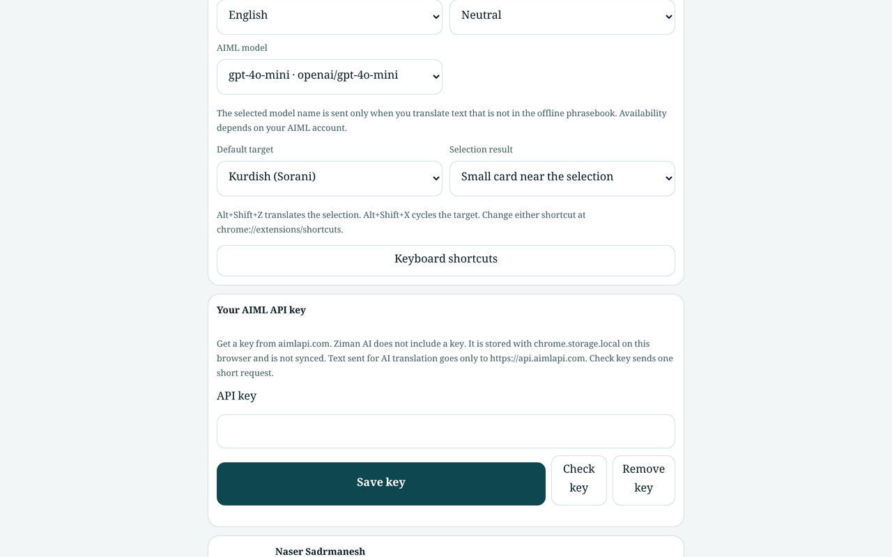
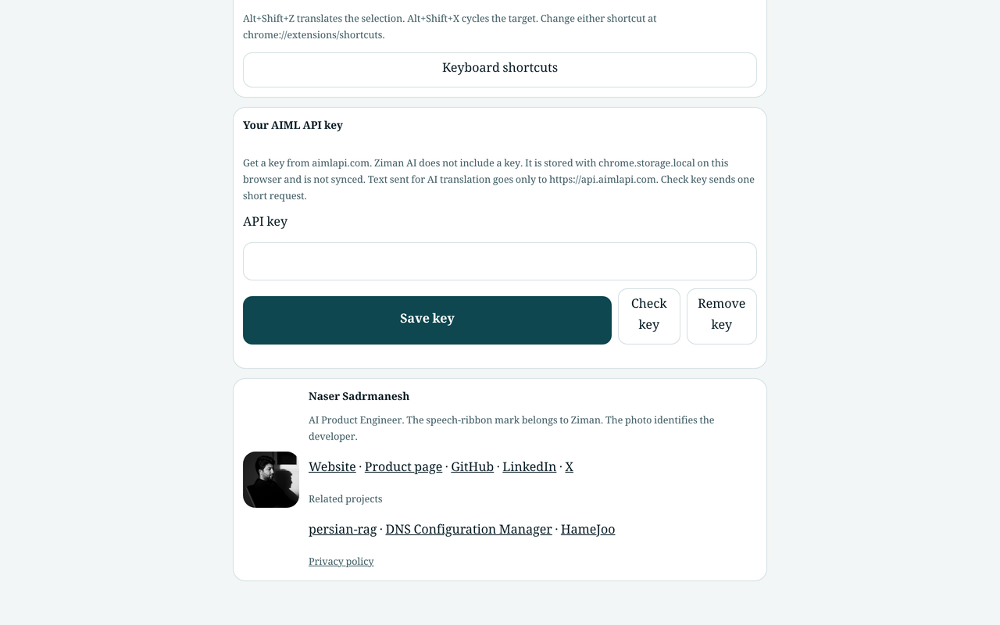
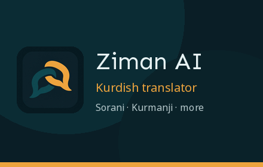

---
hide:
  - navigation
---

# Ziman AI

{ .hero-banner }

A Kurdish (Sorani and Kurmanji) and multilingual translator for Google Chrome. Common phrases are answered from an offline phrasebook on this device. Other sentences use your own [AIML API](https://aimlapi.com/) key. The extension does not include a key, and it does not open when you merely click or select text.

[Get started](getting-started.md){ .md-button .md-button--primary }
[Offline phrasebook](phrasebook.md){ .md-button }
[GitHub](https://github.com/sadrmanesh/ziman-ai){ .md-button }

## Highlights

- **Explicit only.** Right-click selected text and choose **Translate with Ziman**, or press `Alt+Shift+Z`. `Alt+Shift+X` cycles the target language. Nothing runs on a bare click or selection.
- **Offline phrasebook.** 105 phrases in five languages (Sorani, Kurmanji, English, Persian, Arabic) and nine categories, with letter normalization, a “did you mean” suggestion, and a labeled word-by-word fallback.
- **Optional AI translation.** Save your own AIML key in Settings. The key stays in `chrome.storage.local`. Text is sent to `https://api.aimlapi.com` only when you ask for a translation that is not in the phrasebook.
- **Clear errors.** An invalid key, an empty AIML balance, a rate limit, a timeout, and a network failure each have their own message. An empty balance includes a link to AIML billing.
- **A small result card.** The translation appears beside the selection and closes with Escape, a click outside, or a page scroll. Settings can open the popup instead.
- **Local history and favorites.** Recent translations and saved phrases stay on this browser until you clear them.
- **Narrow permissions.** `activeTab`, `storage`, `contextMenus`, `scripting`, and the host `https://api.aimlapi.com/*`.

## Screenshots

Languages: [کوردی سۆرانی](ku.md) · [Kurdî Kurmancî](kmr.md) · [فارسی](fa.md)

## Install

1. Clone [sadrmanesh/ziman-ai](https://github.com/sadrmanesh/ziman-ai) or download a release zip.
2. Open `chrome://extensions/`, turn on Developer mode, and choose **Load unpacked**.
3. Select the folder that contains `manifest.json`.

A Chrome Web Store listing is planned after this source release. Until then, load the extension from source as above. Full steps are in [Getting started](getting-started.md).

## Explore

-   **Getting started**

    ---

    Install from source, try the phrasebook, and optionally add an AIML key.

    [Getting started](getting-started.md)

-   **Shortcuts and context menu**

    ---

    Right-click translation, `Alt+Shift+Z`, `Alt+Shift+X`, and the result card.

    [Shortcuts](shortcuts.md)

-   **Offline phrasebook**

    ---

    Languages, categories, normalization, suggestions, and word-by-word fallback.

    [Phrasebook](phrasebook.md)

-   **AI translation**

    ---

    How to add an AIML key, what is sent, costs, and error messages.

    [AI translation](ai-translation.md)

-   **Privacy**

    ---

    What stays on the device, and when selected text leaves the browser.

    [Privacy](privacy.md)

## Related work

Ziman is part of [Naser Sadrmanesh](https://sadrmanesh.github.io/)’s open-source work on language tools and Chrome extensions.

- Phrase matching uses Arabic, Persian, and Kurdish letter-folding rules adapted from [persian-rag](https://sadrmanesh.github.io/persian-rag/), a Persian-first RAG toolkit.
- Phrasebook lookup quality is measured with a small precision-and-recall script, in the spirit of [llm-search-eval](https://sadrmanesh.github.io/llm-search-eval/).
- Other Chrome extensions: [DNS Configuration Manager](https://sadrmanesh.github.io/chrome-dns-manager/) and [HameJoo](https://hamejoo.github.io/hamejoo-chrome/).

## License

[MIT](https://github.com/sadrmanesh/ziman-ai/blob/main/LICENSE). Copyright (c) 2025 Naser Sadrmanesh.
