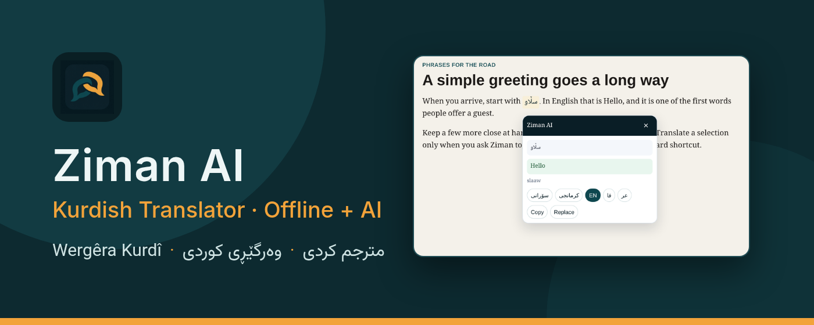
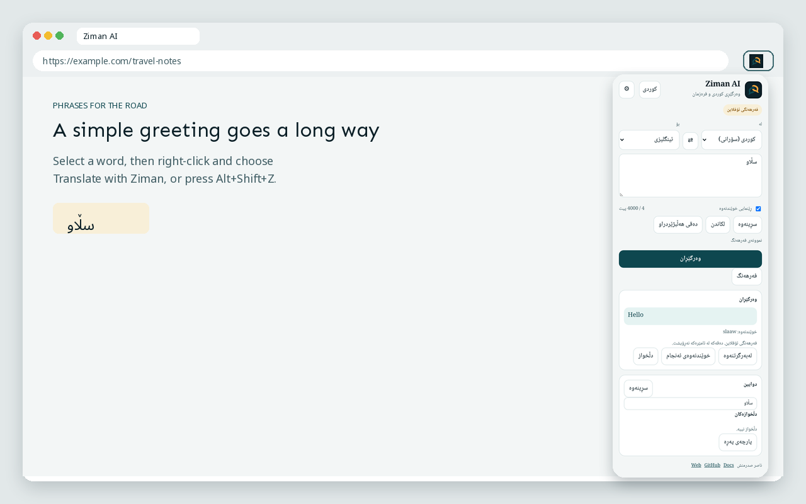
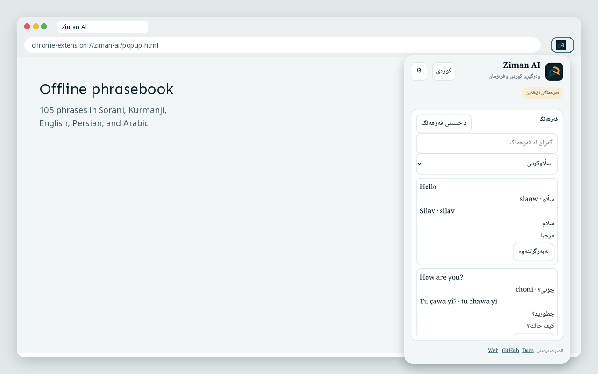
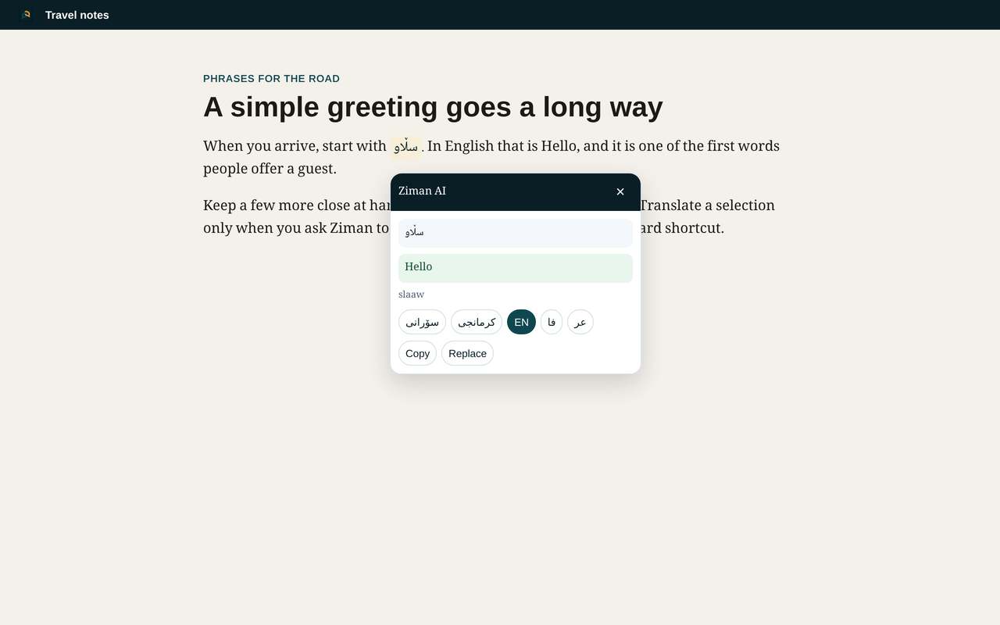

# Ziman – Wergêra Kurdî

{ .hero-banner }

Ziman pêvekeke Chrome ye ji bo wergerandina Kurdî ya Kurmancî û Soranî bo Îngilîzî, Farisî û Erebî, û berevajî. Hevokên berbelav ji ferhenga offline li ser heman amûrê têne bersivandin. Ji bo hevokên din mifteya te ya [AIML](https://aimlapi.com/) pêwîst e. Pêvek bi xwe mifteyekê nade.

Ziman bi klîkekê an tenê bi hilbijartina nivîsê venabe. Wergerandin bi klîka rastê li ser nivîsa hilbijartî û **Translate with Ziman**, an bi `Alt+Shift+Z` dibe. `Alt+Shift+X` zimanê armanc diguherîne.

## Sazkirin

```bash
git clone https://github.com/sadrmanesh/ziman-ai.git
```

Li `chrome://extensions/` moda Developer veke, **Load unpacked** hilbijêre û peldanka ku `manifest.json` tê de ye diyar bike.

## Wêne

<div class="grid screenshot-grid" markdown>







</div>

## Ferheng û zekaya çêkirî

Ferheng 105 hevokan bi pênc zimanan dihewîne: Kurmancî, Soranî, Îngilîzî, Farisî û Erebî. Nivîsa hilbijartî tenê dema ku tu bi xwe wergera bi zekaya çêkirî dixwazî ji `https://api.aimlapi.com` re tê şandin. Mifte tenê di `chrome.storage.local` de dimîne.

Agahiyên zêdetir bi Îngilîzî: [Destpêk](getting-started.md) û [Nepenî](privacy.md).

Pêşdebir: [Naser Sadrmanesh](https://sadrmanesh.github.io/).
