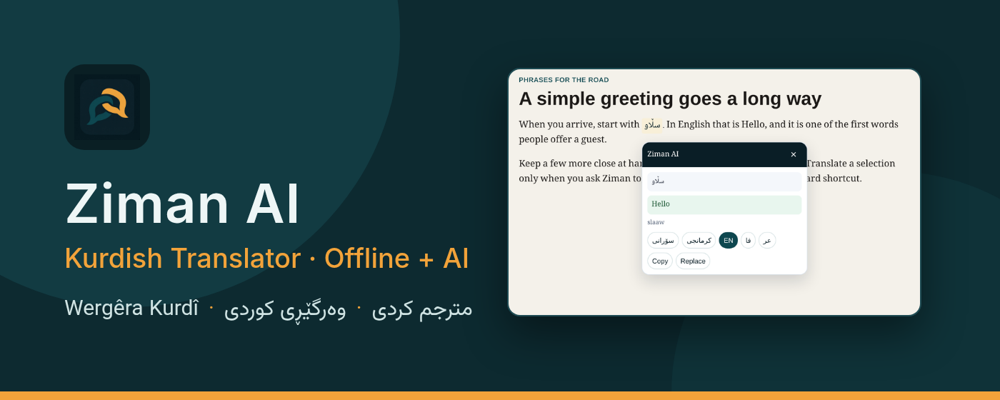
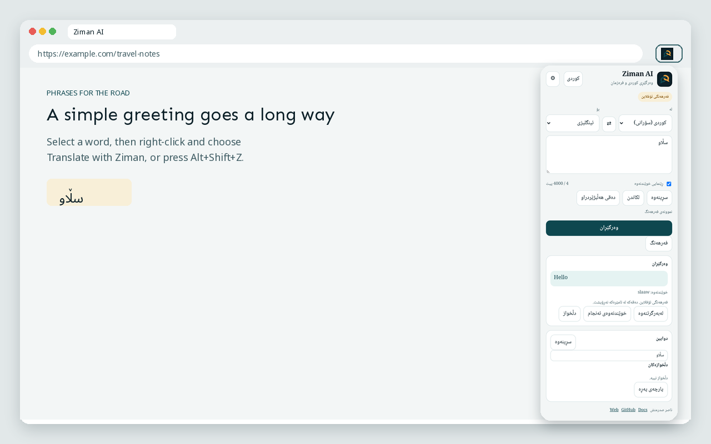
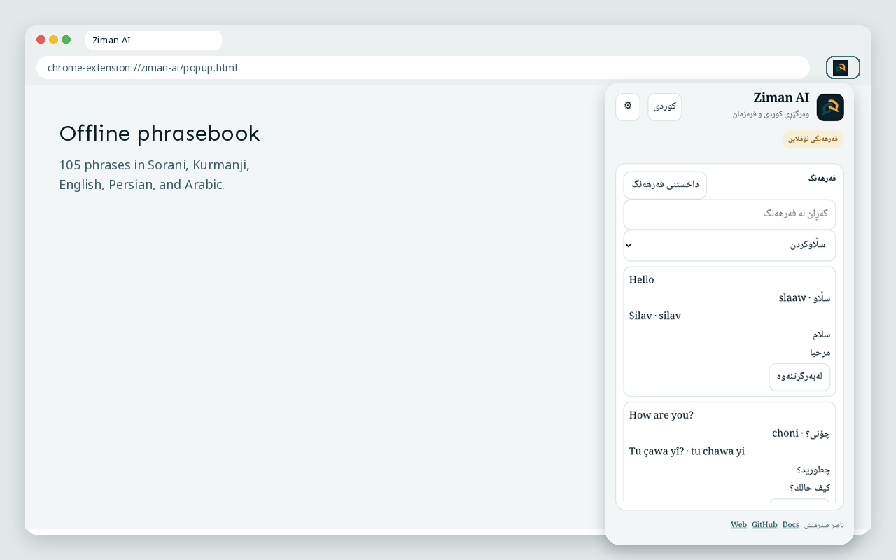
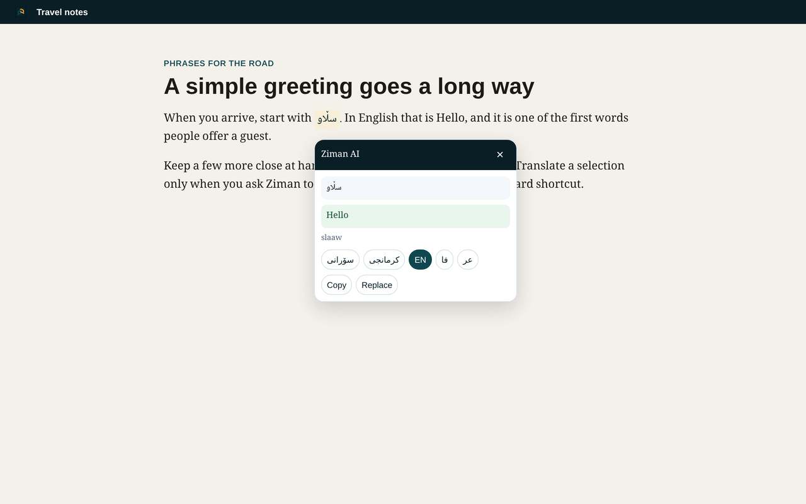

# زمان

{ .hero-banner }

زمان زیادکراوێکی کرۆمە بۆ وەرگێڕانی کوردی سۆرانی و کرمانجی و چەند زمانی تر. دەستەواژە باوەکان لە فەرهەنگی ئۆفلاین و لەسەر هەمان ئامێر وەڵام دەدرێنەوە. بۆ ڕستەی تر پێویستت بە [کلیلی AIML](https://aimlapi.com/)ی خۆت هەیە. زیادکراوەکە کلیلێکی لەگەڵدا نییە.

زمان بە کرتەکردن یان تەنها هەڵبژاردنی دەق نابێتەوە. وەرگێڕان بە ڕاست-کرتە لەسەر دەقی هەڵبژێردراو و هەڵبژاردنی **Translate with Ziman**، یان بە قەدبڕی `Alt+Shift+Z` دەکرێت. `Alt+Shift+X` زمانی مەبەست دەگۆڕێت.

[لە Chrome Web Store دایبمەزرێنە](https://chromewebstore.google.com/detail/ziman-ai-kurdish-translat/cjmmnobnimheoeeojobgfkgbdbohcjkn){ .md-button .md-button--primary }

## دامەزراندن

ئاسانترین ڕێگا [دامەزراندن لە Chrome Web Store](https://chromewebstore.google.com/detail/ziman-ai-kurdish-translat/cjmmnobnimheoeeojobgfkgbdbohcjkn)ە. بۆ وەگێڕانی ناوخۆیی لە سەرچاوە:

```bash
git clone https://github.com/sadrmanesh/ziman-ai.git
```

لە `chrome://extensions/` دۆخی Developer هەڵبکە، **Load unpacked** هەڵبژێرە و ئەو بوخچەیە دیاری بکە کە `manifest.json`ی تێدایە.

«سڵاو» بۆ ئینگلیزی وەربگێڕە؛ وەڵامەکە دەبێت Hello بێت و لە فەرهەنگی ئۆفلاین بێت.

## وێنەکان

<div class="grid screenshot-grid" markdown>







</div>

## فەرهەنگ و زیرەکی دەستکرد

فەرهەنگەکە ١٠٥ دەستەواژە لە پێنج زماندا لەخۆدەگرێت: سۆرانی، کرمانجی، ئینگلیزی، فارسی و عەرەبی. دەقی هەڵبژێردراو تەنها کاتێک بۆ `https://api.aimlapi.com` دەنێردرێت کە خۆت وەرگێڕانی زیرەکی دەستکرد داوا دەکەیت. کلیلەکە تەنها لە `chrome.storage.local` دەمێنێتەوە.

تێبینی زیاتر بە ئینگلیزی لە [دەستپێکردن](getting-started.md) و [تایبەتمەندی](privacy.md)دا هەیە.

گەشەپێدەر: [ناصر صدرمنش](https://sadrmanesh.github.io/).
