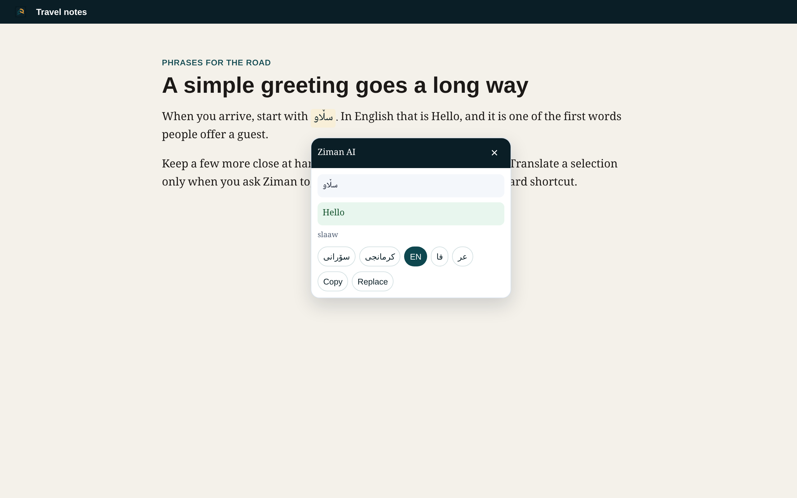

# Shortcuts and context menu

Ziman translates only when you ask it to. It does not show a button, card, or popup when you merely click a page or select text.

## Context menu

1. Select text on a page.
2. Right-click the selection.
3. Open **Translate with Ziman**.
4. Choose a target language, or **last used**.

The five targets are Kurdish (Sorani), Kurdish (Kurmanji), English, Persian, and Arabic. The last-used entry repeats the language you chose most recently, or the default target from Settings if you have not chosen one yet.

## Keyboard shortcuts

| Shortcut | Action |
| --- | --- |
| `Alt+Shift+Z` | Translate the current selection. If nothing is selected, the toolbar popup opens. |
| `Alt+Shift+X` | Cycle the target language: Sorani, Kurmanji, English, Persian, Arabic. |

Both suggestions can be changed at `chrome://extensions/shortcuts`. On some keyboards another extension may already use the same combination; set a different one there.

The **Keyboard shortcuts** button in Settings opens that Chrome page.

## Result card

By default the translation appears in a small card next to the selection. You can copy the result or replace the selected text. The card closes when you:

- press Escape,
- click outside the card, or
- scroll the page.

In Settings, **Selection result** can be set to **Open the popup** instead of the card.

## Toolbar popup

The toolbar icon still opens the full translator: type or paste text, use the current selection, browse the phrasebook, and review history or saved phrases. A **Page excerpt** action, used only after you click it, reads the page title and a short stretch of visible text (about 1,000 characters), not the whole document.
